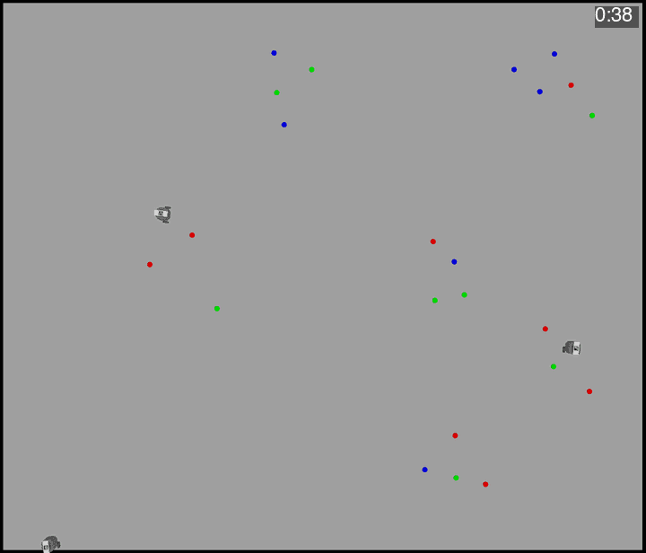

# Autonomous Segregation System (based on the CacheCons algorithm)



| Folder | Contents |
|---|---|
| `models/` | RoboTool project with the RoboSim model (`main.rst`), assertions (`checks.rsa`), diagrams and generated CSP, code and tests |
| `turtlebot3_ws/` | ROS 2 Humble workspace: the `CacheCons` package (state machines, launch file, Gazebo world and models), message packages, the Gazebo GUI and state viewer, and the upstream `turtlebot3`, `turtlebot3_msgs` and `DynamixelSDK` repositories as submodules |
| `macos/`, `Brewfile` | macOS build scripts and dependencies |
| `Images/` | Figures and the simulation recording |
| `RealRobot/` | Single-board-computer workspace, DDS configuration and hardware scripts for the physical TurtleBots |
| `rust/` | Rust terminal client for the robots, and the CacheCons programs generated from the model, which talk to ROS 2 through the `r2r` crate |

## ROS 2 Humble simulation

### Installation

<details>
<summary><b>Ubuntu 22.04 with ROS 2 Humble installed</b></summary>

The simulation runs on Gazebo Harmonic. Install it by following the
[Harmonic installation guide](https://gazebosim.org/docs/harmonic/install_ubuntu/),
and its ROS 2 Humble bridge, `ros-humble-ros-gzharmonic`, by following the
[ROS installation guide](https://gazebosim.org/docs/harmonic/ros_installation/).
Then install the remaining dependencies, clone the repository with its
submodules and build:

```bash
sudo apt-get install python3-colcon-common-extensions ros-humble-tf-transformations
git clone --recurse-submodules git@github.com:UoY-RoboStar/AutonomousSegregation.git
cd AutonomousSegregation/turtlebot3_ws
source /opt/ros/humble/setup.bash
colcon build --build-base build/harmonic --install-base install/harmonic --packages-up-to CacheCons
```

</details>

<details>
<summary><b>macOS on Apple Silicon</b></summary>

Simulation only. Needs the Xcode Command Line Tools and Homebrew. `Brewfile`
lists the dependencies: Gazebo Harmonic from the
[osrf/simulation tap](https://gazebosim.org/docs/harmonic/install_osx/) and the
packages from the
[ROS 2 macOS instructions](https://docs.ros.org/en/humble/Installation/Alternatives/macOS-Development-Setup.html).
`macos/install-ros2.sh` builds ROS 2 Humble from source into `~/ros2_humble`.

```zsh
xcode-select --install
git clone --recurse-submodules git@github.com:UoY-RoboStar/AutonomousSegregation.git
cd AutonomousSegregation
brew trust osrf/simulation
ulimit -n 10240   # Gazebo's build opens more files than the default limit
brew bundle
macos/install-ros2.sh
source macos/setup.zsh
cd turtlebot3_ws
colcon build --build-base build/harmonic --install-base install/harmonic --packages-up-to CacheCons
```

</details>

Python dependencies: NumPy 1.24.4 and transforms3d.

### Running the simulation

From the repository root, run:

<details>
<summary><b>Ubuntu</b></summary>

```bash
source /opt/ros/humble/setup.bash
source turtlebot3_ws/install/harmonic/setup.bash
ros2 launch CacheCons CC_launch.py
```

</details>

<details>
<summary><b>macOS</b></summary>

```zsh
source macos/setup.zsh
source turtlebot3_ws/install/harmonic/setup.zsh
ros2 launch CacheCons CC_launch.py
```

</details>

This opens Gazebo Harmonic with three TurtleBot3 Burgers performing the CacheCons task. Ctrl+C stops it.

Launch options go after the command, for example
`ros2 launch CacheCons CC_launch.py num_robots:=1 headless:=true`.

| Option | Default | Effect |
|---|---|---|
| `num_robots` | `3` | Number of robots, 1 to 3, named `T3A`, `T3B` and `T3C` |
| `controller` | `single` | `nodes` runs each robot's six state machines as separate nodes instead of one controller node; a comma-separated list of machine names, such as `move_manager,random_walk`, runs only those |
| `headless` | `false` | `true` runs without the Gazebo window |
| `state_viewer` | `true` | Shows the state-machine window when the Gazebo window runs |
| `random_seed` | `0` | Seed for the puck layout and for each robot's initial cache points |
| `cluster_distance` | `0.25` | Metres within which same-colour pucks belong to one cluster |
| `obstacles` | `true` | `false` removes the box and cylinder obstacles |
| `overhead_camera` | `false` | `true` takes each robot's pose from the ArUco tag on its top plate, seen by an overhead camera, instead of from Gazebo |
| `overhead_camera_rate` | `5.0` | Overhead camera frames per second; its 4096 by 3520 pixel frames slow the simulation at higher rates |
| `limit_real_time_factor` | `true` | `false` runs as fast as the PC allows |
| `calibrate_camera` | `none` | `onboard` or `overhead` captures that camera's calibration table instead of running the simulation |
| `calibration_output` | | Path of the table to write, required with `calibrate_camera` |
| `domain_id` | `31` | ROS domain |

The simulation uses Cyclone DDS on ROS domain 31, so it does not interfere
with the physical robots. If your shell sets `CYCLONEDDS_URI` for the physical
robots, run `unset CYCLONEDDS_URI` before launching.

### Camera calibration

The simulation converts camera pixels to floor positions with a calibration
table for each camera, kept in `turtlebot3_ws/src/CacheCons/data/calibration`.
To record the onboard camera's table again, run from the repository root:

```bash
ros2 launch CacheCons CC_launch.py calibrate_camera:=onboard calibration_output:=turtlebot3_ws/src/CacheCons/data/calibration/OnboardCalibration_sim.csv
```

This moves a marker through a grid in front of one robot, writes the table and
exits. Rebuild afterwards so the simulation uses the new table.

`calibrate_camera:=overhead` records `OverheadCalibration_sim.csv` the same way
by moving the robot through the arena.

### Troubleshooting

If Gazebo does not exit cleanly, first try the polite SIGTERM:

```bash
killall gzserver gzclient
```

and only if that fails, SIGKILL:

```bash
killall -9 gzserver gzclient
```

### Obstacle avoidance (real robot) demo

1. Ensure that `cyclonedds.xml` is referenced in your shell, for example `export CYCLONEDDS_URI=file://$HOME/cyclonedds.xml`.
2. SSH into the TurtleBot and bring it up: https://emanual.robotis.com/docs/en/platform/turtlebot3/bringup/#bringup
3. On the host PC, run `ros2 run CacheCons stateMachine1_real`.

## RoboSim d-model 
### Module: `CacheConsM`
 
The top-level module defines:
 
- **Cycle period**: 1 time unit (configurable at code generation).
- **Robotic platform**: `TurtleBot`
- **Controller**: `CacheConsC`
### TurtleBot Interfaces
 
**Provided interfaces** (services offered to the controller):
- `Move` — controls robot movement via `move(cmd: Vec2)` (angular and linear velocity)
- `IObjectOps` — provides `PickUpObject()` and `DepositObject()` to operate the gripper
**Defined interfaces** (events sent to the controller):
- `ObstacleEvents` — `closestDistance` and `closestAngle` from the laser scanner
- `IStatus` — `ObjectCarried` boolean event (gripper status)
- `IVisibleClustersCC/CA/TW` — cluster and object data (count, `ClusterData`, `ObjectData`)
- `ICoord` — `Coord_O` event with the robot's position
---
 
### Controller: `CacheConsC`
 
Contains **state machines**:
 
| State Machine | Role |
|---------------|------|
| `CacheConsS` | Core CacheCons segregation algorithm |
| `ObstacleAvoidance` | Simple obstacle avoidance |
| `RandomWalk` | Exploratory behaviour for object searching |
| `MoveManager` | Priority-based arbitration of movement commands |
| `TargetWatch` | Identifies the closest valid target object |
| `CachePointAssignment` | Manages and updates cache locations per cluster type, keeping caches of different types apart |
 
**Movement priority** (highest to lowest): Obstacle Avoidance → Cache Construction → Random Exploration
 
---
 
### Core State Machine: `CacheConsS`
 
Implements the CacheCons algorithm through **six composite states**:
 
| State | Behaviour |
|-------|-----------|
| `PU_SCAN` | Scans for clusters; selects an object target; enables random walk and obstacle avoidance |
| `PU_TARGET` | Navigates toward the target using pose and target location data; approaches to pick up |
| `HOMING` | Navigates robot to the appropriate cache point after collecting an object |
| `DE_PUSH` | Slowly pushes the object into the cache location for a timed duration |
| `DE_BACKUP` | Drops the object (`DepositObject()`), then moves the robot backwards |
| `EXILE` | Moves robot away from the cache point before returning to `PU_SCAN` |
 
Key behaviours include:
- **Timer-based transitions** to handle timeouts and cycle advancement via the `exec` event.
- **Accidental pick-up handling** — a direct `PU_SCAN → HOMING` transition if an object is unexpectedly collected.
- **Passive gripper support** — repeated `DepositObject()` calls until the object is confirmed dropped.
- **Cache points from the start** — every object type has a cache point, initially the model parameter `initialCaches`, which `CachePointAssignment` replaces with the largest observed cluster of that type and resets when cache separation removes it.
---
 
### Key Data Types
- `ClusterData` — cluster size, type, and centroid location
- `ObjectData` — object position, cluster association, and ID
- `Vec2` — 2D vector for positions and velocity commands
